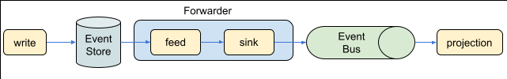
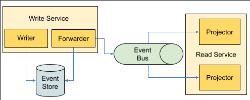
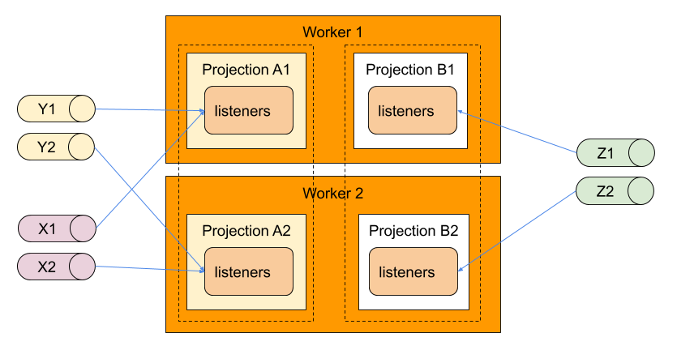

# Event Sourcing

A comprehensive event sourcing library implementation using databases as event stores, with support for CQRS architecture patterns.

## Introduction

This project implements an event store that can be used with Event Sourcing + CQRS architecture patterns, where the write and read sides can scale independently.

The library provides a common interface to store domain events in databases (MongoDB, MySQL, PostgreSQL) and stream events to message buses (NATS, Kafka) for consumption by projections.

Beyond the event store and streaming capabilities, this project includes complete infrastructure for building and managing projections.

> **Note**: Creating projections may take hours or days depending on event history volume. It's recommended to create projections using a blue/green deployment strategy.

## Supported Technologies

**Event Stores:**
* MySQL
* PostgreSQL
* MongoDB

**Message Buses:**
* NATS
* Kafka

## Key Features

* **Event Store Database**: Persistent storage for domain events
* **Snapshots**: Performance optimization for aggregate reconstruction
* **GDPR Compliance**: Event forgetting capabilities
* **Discriminators**: Additional fields/columns for event filtering
* **Reactive Streaming**: Real-time database change propagation to message buses
* **Outbox Pattern**: Reliable event publishing with polling mechanism
* **Transaction Hooks**: Custom logic execution during event persistence
* **Projections**: Read model generation and management
* **Event Replay**: Historical event processing from any point in time
* **Message Bus Partitioning**: Load distribution for non-key-partitioned systems
* **Event Migration & Upcasting**: Schema evolution support

> **Warning**: Code examples below may be outdated

## Quick Start

This example demonstrates a MySQL event store producing events to Kafka and projecting them.

### Codec Registry

```go
func NewJSONCodec() *jsoncodec.Codec[ids.AggID] {
	c := jsoncodec.New[ids.AggID]()
	c.RegisterFactory(KindAccount, func(id ids.AggID) eventsourcing.Kinder {
		return DehydratedAccount(id)
	})
	c.RegisterFactory(KindAccountCreated, func(_ ids.AggID) eventsourcing.Kinder {
		return &AccountCreated{}
	})
	c.RegisterFactory(KindMoneyDeposited, func(_ ids.AggID) eventsourcing.Kinder {
		return &MoneyDeposited{}
	})
	c.RegisterFactory(KindMoneyWithdrawn, func(_ ids.AggID) eventsourcing.Kinder {
		return &MoneyWithdrawn{}
	})
	c.RegisterFactory(KindOwnerUpdated, func(_ ids.AggID) eventsourcing.Kinder {
		return &OwnerUpdated{}
	})
	return c
}

func DehydratedAccount(id ids.AggID) *Account {
	reg := eventsourcing.NewRegistry()
	a := &Account{
		RootAggregate: eventsourcing.NewRootAggregate(reg, id),
		_reg:          reg,
	}
	eventsourcing.EventHandler(reg, a.handleAccountCreated)
	eventsourcing.EventHandler(reg, a.handleMoneyDeposited)
	eventsourcing.EventHandler(reg, a.handleMoneyWithdrawn)
	eventsourcing.EventHandler(reg, a.handleOwnerUpdated)
	return a
}
```

### Event Store Producer

```go
esRepo := mongodb.NewStoreDB(client, cfg.EsName)
es := eventsourcing.NewEventStore(esRepo, cfg.SnapshotThreshold, entity.Factory{})

// Interact normally with the aggregate and save
id := uuid.New().String()
acc := test.CreateAccount("Paulo", id, 100)
acc.Deposit(10)
acc.Withdraw(20)
es.Create(ctx, acc)

// Retrieve the aggregate
a, _ = es.Retrieve(ctx, id)
acc2 := a.(*Account)
```

### Event Forwarder

```go
logger := ... // slog
config := ... // get configuration into your custom structure

// store
kvStore := mysql.NewKVStoreWithURL(config.Url, "resumes")

// sink provider
sinker, _ := kafka.NewSink[ids.AggID](logger, kvStore, "my-topic", 1, config.KafkaUris)

dbConf := mysql.DBConfig{
	Host:     config.Host,
	Port:     config.Port,
	Database: config.Database,
	Username: config.Username,
	Password: config.Password,
}
feed, _ := mysql.NewFeed(logger, dbConf, sinker)

// Setting nil for the locker factory means no lock will be used.
// When we have multiple replicas/processes forwarding events to the message queue,
// we need to use a distributed lock.
forwarder := projection.EventForwarderWorker(logger, "forwarder-id", nil, feed.Run)
worker.RunSingleBalancer(ctx, logger, forwarder, 5*time.Second)
```

### Projection Implementation

```go
type MyProjectionV1[K eventsourcing.ID] struct {
	checkpoints projection.Checkpoints[K]
	txRunner    store.TxRunner
	// other fields like repositories
}

func NewMyProjectionV1[K eventsourcing.ID](checkpoints projection.Checkpoints[K]) MyProjectionV1[K] {
	return MyProjectionV1[K]{
		checkpoints: checkpoints,
	}
}

func (p *MyProjectionV1[K]) Name() string {
	return "my-name"
}

func (*MyProjectionV1[K]) CatchUpOptions() projection.CatchUpOptions {
	return projection.CatchUpOptions{}
}

func (p *MyProjectionV1[K]) Handle(ctx context.Context, msg projection.Message[K]) error {
	return p.checkpoints.Handle(ctx, msg, func(m *sink.Message[K]) error {
		// do your stuff
		return nil
	})
}
```

### Projection Consumer

```go
logger := ... // slog

esRepo, _ := mysql.NewStoreWithURL[ids.AggID](dburl) 
// If the projection is part of another service and we cannot access the database directly
// we can use the grpc repo
// esRepo := projection.NewGrpcRepository[ids.AggID](serviceAddr)

sub, _ := kafka.NewSubscriberWithBrokers[ids.AggID](ctx, logger, kafkaUris, "my-topic", nil)
// store
kvStore := mysql.NewKVStoreWithURL(dbConfig.Url, "resumes")

// We can use different db connection than the previous kvStore
db := ... // mysql db connection
cpStore := mysql.NewKVStore(db, "my_name_checkpoints")
proj := NewMyProjectionV1[ids.AggID](store.TxRunner(db), projection.NewCheckpoints[ids.AggID](cpStore))

// Repository here could be remote, like GrpcRepository
projector := projection.Project(logger, nil, esRepo, sub, proj, kvStore, 1)
projector.Start(ctx)
```

### Writing to Aggregates

```go
// codec registry
reg := NewJSONCodec()
store, _ := mysql.NewStoreWithURL[ids.AggID](url)
es := eventsourcing.NewEventStore[*account.Account, ids.AggID](store, reg, nil)

acc, _ := account.New("Paulo", 100)

acc.Deposit(10)
acc.Deposit(20)

es.Create(ctx, acc)
```

## Architecture Overview

### Components

The library consists of the following main components:

- **Event Store**: Database utility for reading/writing events
- **Database Change Listeners**: Propagate database changes to message streams
- **Outbox Pattern**: Reliable message delivery
- **Message Stream Listeners**: Build projections from event streams

> **Projections**: Can be rebuilt from the beginning of time

### Eventually Consistent Projections

A service **writes** to a **database** (the event store), a **forwarder** component listens to database inserts (change stream) and forwards them to an **event bus**. A **projection** service then listens to the event bus and creates the necessary read models.



> We can still use consistent projections to build the current state of an aggregate.
> 
> To use CQRS, it's not mandatory to have separate databases or plug change streams into the database.
> We can write the read model to the same database in the same transaction as the write model (dual write).

## Implementation Guide

This section assumes familiarity with event sourcing and CQRS concepts.

### Aggregates

Aggregates must "extend" `eventsourcing.RootAggregate` (which implements the `eventsourcing.Aggregater` interface) and implement the `eventsourcing.Kinder` interface. Any change to the aggregate is recorded as a series of events.

Example: [test/aggregate.go#L103](./test/aggregate.go#L103)

### Factory

Since we deserialize events, we need a factory to instantiate aggregates and events. This factory can be reused on the read side to instantiate events.

Example: [test/aggregate.go#L60](./test/aggregate.go#L60)

### Codec

To encode and decode events to/from binary data, provide an `eventsourcing.Codec`. This can be as simple as a wrapper around `json.Marshaller/json.Unmarshaller` or a more complex implementation involving a schema registry.

### Upcaster

As applications evolve, domain events may change, making previously serialized events incompatible with current event schemas. When rehydrating events, transform them to higher versions using the `eventsourcing.Upcaster` interface.

> Alternative: Use [event migration](./eventstore.go#L105)

### Events

Events must implement the `eventsourcing.Eventer` interface.

Example: [test/aggregate.go#L31](./test/aggregate.go#L31)

### Event Store

Event data can be stored in any database. Current implementations:
* PostgreSQL
* MySQL
* MongoDB

### Projections

Two types of projections are implemented.
Consistent Projections and Eventually Consistent Projections

#### Consistent Projections

Consistent projections are created in the same transaction when saving the events in the event store,
therefore they are created in the same event store database.

This is the easiest to implement and the projection data is immediately available but as an impact in performance since new write needs to be done.

##### Migration

**Not yet implemented**

Consider that we want to migrate a projection for a table called `users` that stores all users in the system.

Here are the steps to migrate:

1) create the new `users2` table. The `users` table is still used to process incoming events

2) when a new event is processed, we update `users` and the new `users2` will only be updated if the given aggregate already exists

3) if a new aggregate is being created, we insert it both in `users` and `users2`

4) finally, for each aggregate (user) in the system, we calculate the new state from all events of the aggregate, and save the result to `users2`. In each transaction which updates the state for a single aggregate, we additionally insert a **no-op** event for that aggregate with an incremented version number. This blocks the update process of any commands that might produce events for this aggregate concurrently. By inserting an event with the next version number, we ensure that we won’t miss any events during the snapshot reconstruction.

5) once this is done, we can remove any logic that updated or used `users` and drop it from the database.

#### Eventually Consistent Projections

Eventually consistent projections makes use of an additional piece of software, and event bus, responsible to propagate the events to another part of the system.

##### Forwarder

After storing the events in a database we need to publish them into an event bus.

In a distributed system where we can have multiple instance replicas of a service, we need to avoid duplication of events being forwarded to the message bus, for performance reasons.
To avoid duplication and **keep the order of events** we can have only one active instance of the forwarding process/service using a distributed lock to elect the leader.

##### Rebuilding a projection

If a a projection needs to be rebuild, due to a breaking change, the best strategy is to create a **new** projection, replay all events, and switch to it when the catchup is done. This way will never have a down time for a projection.

> Depending on the number of events to be processed, this can take hours or even days. This can be mitigated by using a large batch size and discriminators when defining a projection.

The process for creating a new projection at boot time, is described as follow:

Boot Partitioned Projection
- Wait for lock release (if any)
- Replay all events from the last recorded position from the event store up to a safe time margin (Catchup).
- Switch to the event bus and start consuming from the last event position (Live).

> A projection never switches back to catchup.

##### Idempotency

A projection must be idempotent.

There are several ways to make a [projection idempotent](https://event-driven.io/en/projections_and_read_models_in_event_driven_architecture/#idempotency). 

Using this library, projection idempotency can be achieved by recording the last handled event. Events delivered to a projection go through two phases: The catchup and live phase.

An event delivered to a projection will have metadata that describes in what phase the event is coming from, the name of the projector, the partition number and the sequence number. Sequence number is only populated on live phase.

Events are delivered to a projection through a named projector. Several projectors can be used to deliver events to the same projection through different different topics and partitions.

When the events are delivered on the **catchup** phase, the event ID is guaranteed to be monotonic so we can use it as the checkpoint. If a redelivery happens we just need to compare it with the last event and reject it if it is lesser or equal than the last recorded one.

When the events are delivered on the **live** phase from the stream, the event ID is no longer guaranteed to be monotonic, but now we can use the sequence of each partition as the checkpoint.

Events will only change to **live** phase/mode when all events in **catchup** mode are consumed and acknowledged. In between, a control event (switch kind) will be sent with an event ID where no future received events should be lesser or equal.

To make the projection idempotent what we have to do is:
- under the projector name and partition, record the **event ID**, if catching up, otherwise record the **sequence** and the last event ID in catchup mode, if any. Use the control event to record the threshold event ID.
- when handling the event, reject events that are less or equal than the threshold event ID. If not reject by the previous condition and if in live mode, reject if the received sequence is less or equal than the last recorded sequence.

An utility providing what was described above provided [here](./projection/checkpoints.go)

See the code above an example of its use for the projection `MyProjectionV1`.

### Event Migration

TODO: Implementation following the copy-and-replace pattern.

Reference: https://leanpub.com/esversioning/read#leanpub-auto-copy-and-replace

## gRPC Code Generation

```sh
./codegen.sh ./api/proto/*.proto
```

---

## Design Rationale

This section explains the reasoning behind key design decisions.

### Event Bus Challenges

One key challenge is storing events in a database and propagating them to an event bus without losing events. It's impossible to write to a database and publish to an event bus in a single transaction with guaranteed consistency.

Publishing events only after successful database insertion doesn't guarantee success, as the commit may still fail, creating inconsistency between the database and published events.

**Solution**: Write to the database first, then have a separate process capture database changes.

Two approaches are implemented: **Polling** and **Pushing** (recommended).

### Event Ordering

Initially, monotonic event IDs were intended for easy event replay when building projections.

Global monotonic events are impossible without a single-node writer (creating a bottleneck). Even with single-node writes, concurrent transactions don't guarantee order without node-level locks (creating greater bottlenecks).

**Challenges with Distributed ID Generation:**
- No guarantee of monotonic IDs between nodes due to clock skews and algorithm randomness  
- Records may not become available in ID order

	Consider two concurrent transactions relying on database sequence. One acquires the ID 100 and the other the ID 101. If the one with ID 101 is faster to finish the transaction, it will show up first in a query than the one with ID 100. The same applies to time based IDs.
	If we have a polling process that relies on this number to determine from where to start polling, it could miss the last added record, and this could lead to events not being tracked. Luckily this can be addressed by using the outbox pattern.

**Solution**: When replaying events, start from a sufficiently large time offset (typically 1 minute) before the last recorded event to account for clock skews and ordering issues.

### Event IDs

Event IDs are incremental (monotonic) to improve insert performance.

**Requirements:**
1. Monotonic per aggregate
2. Global time-based ordering

**Implementation**: [oklog/ulid](https://github.com/oklog/ulid) addresses both requirements.

Since SQL databases use numbers for incremental keys and NoSQL databases use strings/UUIDs, string-based event IDs are used.

### Change Data Capture (CDC) Strategies

Events in the event store must be forwarded to processes building projections. This requires monitoring the event store for new events.

Since the event store only allows inserts (events are immutable), CDC focuses solely on insert operations.

Two strategies are implemented: **Pushing** (recommended) and **Polling**.

#### Pushing (Recommended)

Modern databases provide change streaming capabilities. When events are inserted, change listeners capture and forward them.

**Examples:**
- MongoDB: [Change Streams](https://docs.mongodb.com/manual/changeStreams/)
- PostgreSQL: Logical replication
- MySQL: Binary logs

All change streams must support resumption from specific positions or timestamps.

**Supported databases:**
- MongoDB
- PostgreSQL  
- MySQL

#### Polling with Outbox Pattern

Polling works with any database supporting transactions. Use when databases lack change streaming or require expensive licenses.

**Process:**
1. Store events with incremental, sortable keys (monotonic per aggregate)
2. Write to both event store and outbox table
3. Poller queries outbox for new events
4. Publish events to message bus and delete from outbox

**Advantages:**
- Easy to implement
- Works with all databases

**Disadvantages:**
- Network overhead with infrequent updates
- Polling inefficiency

### Snapshots

Snapshots use the memento pattern to capture aggregate state every X events.

Snapshots improve event store performance for aggregate retrieval but don't affect consistency. Failed snapshot saves are acceptable since they can be saved in separate transactions asynchronously.

## Event Sourcing + CQRS Architecture

Event sourcing models application changes as a series of events. Application state at any point can be reconstructed by replaying events from the beginning.

CQRS (Command Query Responsibility Segregation) is commonly used with event sourcing.

### Architecture Overview



**Flow:**
1. Write service writes to database (event store)
2. Forwarder component captures changes and publishes to event bus
3. Read service listens to event bus and updates views

> The forwarder could be a separate service, but accessing another service's database is generally discouraged.

### Event Replay

When forwarder components restart, they resume from either the event store or event bus, depending on the last consumption point.

**Replay Process:**
1. Consume messages from event store until X seconds ago (default: 1 minute)
2. Track last consumed event ID
3. Set next sequence to consume from 2×X seconds ago
4. Switch to event bus
5. Track last consumed sequence number
6. On restart, resume from last saved position

For breaking projection changes, create a new projection version, let it catch up, then switch to it.

### GDPR Compliance

GDPR requires complete removal of personally identifiable information. Deletion or encryption key removal is insufficient.

This means event store data must change, violating the append-only rule. However, event buses with limited retention windows (30-day GDPR compliance requirement) avoid this issue.

## Performance Optimization

### Key Partitioning for Message Buses

Read sides may become bottlenecks with increased aggregates and database operations. Key partitioning distributes load across service instances.

> No stream messaging solution provides dynamic key partitioning with automatic rebalancing as nodes change.

**Implementation Example (12 partitions):**

**Forwarder Side:**
```go
topicNr := hash(event.ID) % 12
// Publish to topic.1, topic.2, ..., topic.12
```

**Consumer Side:**
Create partition slots balanced across instances. Each instance tracks all instances and adjusts slot ownership.

**Example: 3 replicas with slots `PARTITION_SLOTS=1-4,5-8,9-12`**

Formula: `x = (number of slots) / (number of members)`

- 1 instance: locks all slots (x=3/1=3)
- 2 instances: instance #1 releases 1 slot (x=3/2≈2)  
- 3 instances: each locks 1 slot (x=3/3=1)

**Limitation:** Not elastic - adding/removing partitions requires manual intervention. Start with sufficient partitions to minimize impact.

**Load Distribution Example:**
```
2 instances: #1(1-6), #2(7-12)
3 instances: #1(1-4), #2(5-8), #3(9-12)
```

Idempotency is maintained for each aggregate.

### Event Forwarder Scaling

When event write rates exceed forwarder capacity, creating additional forwarding processes distributes the load.

> Using one forwarder service per write service typically prevents bottlenecks.

#### Discriminator-Based Distribution

Filter events by discriminators (business-specific labels). Examples:
- One forwarder per aggregate type
- One forwarder per aggregate type set
- Events stored with generic labels for filtering

Each forwarder sends events to separate event bus topics.

#### Partition-Based Distribution

Distribute events across partitions and balance partitions among forwarder instances.

**Example:** 2 forwarder instances with 12 partitions = 6 partitions per instance.

```go
lockPool, _ := consullock.NewPool(consulURL)
lockFact := func(lockName string) lock.Locker {
    return lockPool.NewLock(lockName, lockExpiry)
}

partitionSlots, _ := worker.ParseSlots("1-6,7-12")
partitions := uint32(12)
sinker, _ := nats.NewSink(logger, cfg.Topic, partitions, cfg.NatsURL)
taskerFactory := func(partitionLow, partitionHi uint32) worker.Tasker {
	return mongodb.NewFeed(logger, connStr, eventstoreName, sinker, 
		mongodb.WithPartitions(partitions, partitionLow, partitionHi))
}

workers := projection.EventForwarderWorkers(ctx, logger, "forwarder", 
	lockFact, taskerFactory, partitionSlots)
```

> Client-side balancing requires distributed locks. Redis and Consul implementations provided.

### Client Balancing for Message Buses

For message queues lacking consumer groups, the internal client balancer ensures only one worker handles messages per partition.



**Example Scenario:**
- Topic X: 2 partitions  
- Topic Y: 3 partitions
- Server #1: consumes Y1, Y2, X1
- Server #2: consumes X2, Y3

**Load Distribution Formula:** `locks = workers / instances`

Workers are distributed to prevent any instance from locking all workers. If remainder exists, instances lock additional workers only after all have their share.

**Scaling Example (4 workers, increasing replicas):**
1. Replica #1: locks all 4 workers
2. Replica #2 joins: #1 releases 2, #2 locks them  
3. Replica #3 joins: #1 and #2 each release 1, #3 locks 1
4. Additional replicas balance remaining workers
